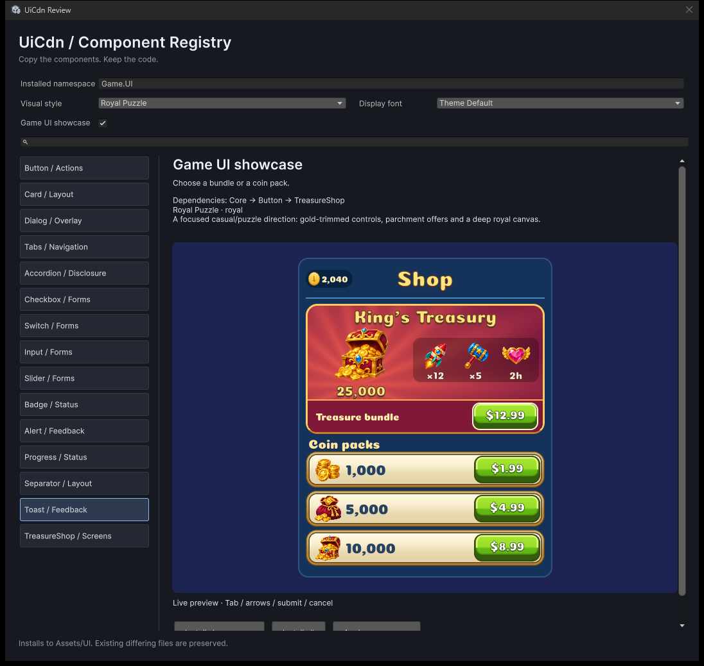
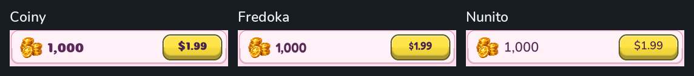
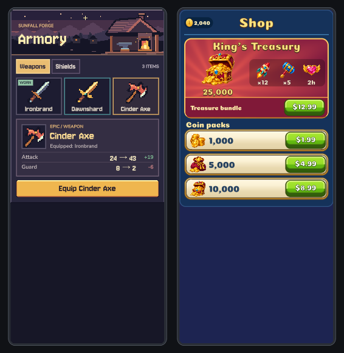
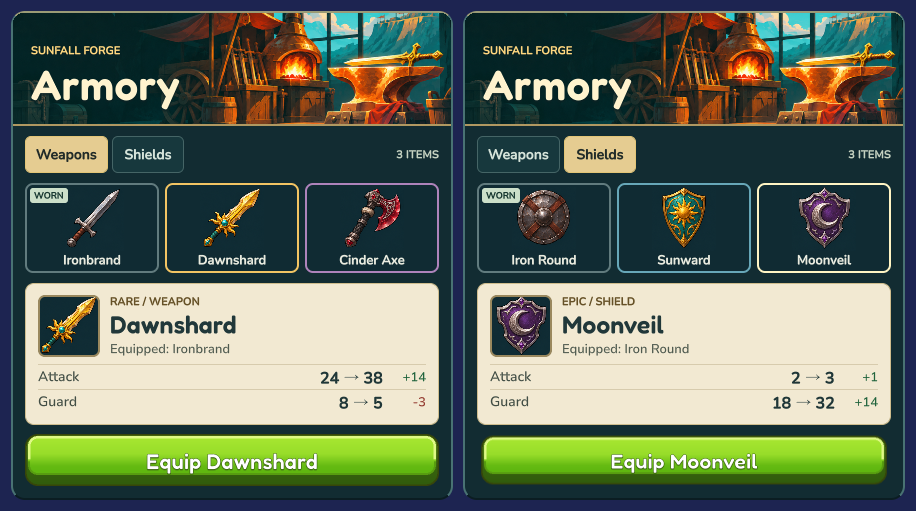
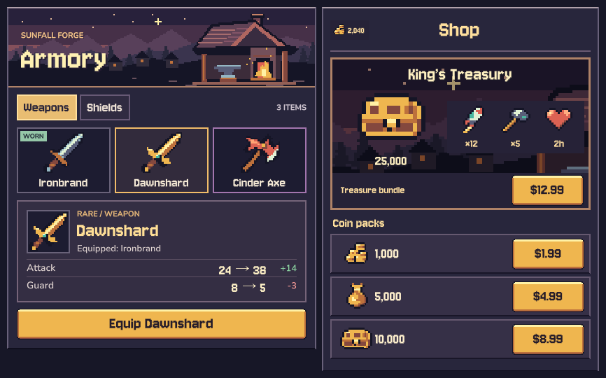
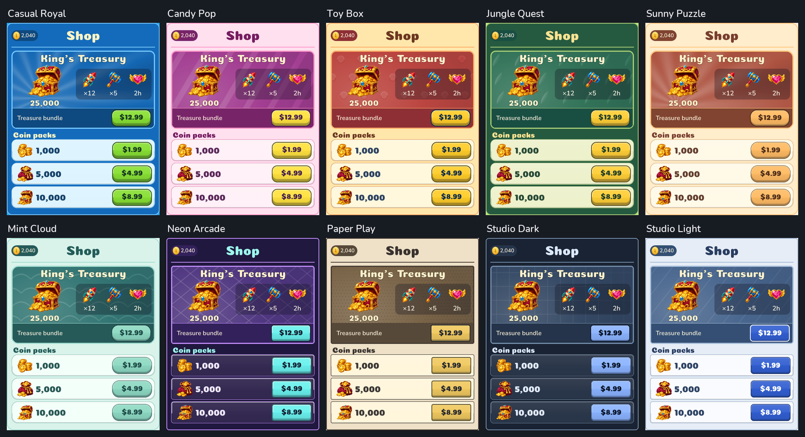

# UiCdn

**Copy the components. Keep the code.** An MIT-licensed component registry for Unity 6 runtime UI Toolkit, inspired by shadcn/ui.

The UPM package is an **Editor-only installer**. It copies C#, UXML, USS, themes, and an AI reference guide to your chosen project folder (default `Assets/UI`). Installed components use only the engine's runtime UI Toolkit APIs. You can remove the package afterward.



## Install the tool

To install a published OpenUPM version, run `openupm add com.garabandic.uicdn` from your Unity project directory. In Package Manager settings you can also add a scoped registry named `OpenUPM` with URL `https://package.openupm.com` and scope `com.garabandic.uicdn`, then install UiCdn from **My Registries**. Downloadable tarballs are available from [GitHub Releases](https://github.com/kantagara/UI-CDN/releases).

Requires Unity 6 (`6000.0` or later). Use Package Manager → **Install package from disk** and select this folder's `package.json`. The package may also be embedded at `Packages/com.garabandic.uicdn` or installed from your Git repository using `?path=/Packages/com.garabandic.uicdn` after the repository URL. No third-party runtime packages are required. The dependency on the engine's built-in `com.unity.modules.uielements` module enables its runtime APIs; keep that module enabled after removing the installer.

Open **Window → UiCdn → Component Registry**. Search the catalog, inspect its dependencies and working preview, set the namespace (default `Game.UI`), and drag a folder from the Project window onto **Install folder**. You can also type an existing Assets path and press Enter. Choose **Install** or **Install all** to copy directly into that folder. Clear the field to restore `Assets/UI`. To relocate an existing installation, move its whole folder in the Project window, then select its new location. The first installation also initializes themes, the license, and `AGENTS.md` in the selected folder. Configuration is a project-local `UiCdnSettings` ScriptableObject saved in `ProjectSettings/UiCdnSettings.asset`.

Choose **Visual style** and **Display font** independently. New configurations start with **Royal Puzzle** and **Theme Default**. Enable **Game UI showcase** and choose a **Genre / screen** to try the casual shop or RPG equipment screen. Choose **Apply appearance** to use the selected theme and display font in installed screens. Coiny has wide, playful lettering. Fredoka SemiBold has softer, narrower letterforms. Nunito SemiBold offers a quieter option for dense menus.



## Preview a phone layout

Open **Preview size** above the example. **Phone portrait** lays it out at 390 × 844 UI Toolkit points. **Phone landscape** rotates that viewport to 844 × 390. Click or navigate the controls and scroll inside the frame for longer screens. Switching back to **Full width** keeps the current example and its state. Check device-specific safe areas, pixel density and touch input on your target hardware.



## Use the installed files

Add `ui.uss` from the selected installation folder to your document's style sheets. Add the classes `ui-root ui-theme-selected` to the document root. Use the default runtime theme on your Panel Settings so built-in text inputs, toggles, and sliders have their native visuals. Assign the UXML to your `UIDocument` in your Unity 6 scene.

```xml
<ui:UXML xmlns:ui="UnityEngine.UIElements" xmlns:g="Game.UI">
    <ui:Style src="ui.uss" />
    <ui:VisualElement class="ui-root ui-theme-selected ui-stack">
        <g:UiCard>
            <g:UiCardHeader>
                <g:UiCardTitle text="Adventure awaits" />
                <g:UiCardDescription text="Your UI. Your source code." />
            </g:UiCardHeader>
            <g:UiCardContent>
                <g:UiInput label="Player name" value="Wayfarer" />
                <g:UiSwitch text="Music" value="true" />
            </g:UiCardContent>
            <g:UiCardFooter>
                <g:UiButton name="start" text="Start adventure" />
            </g:UiCardFooter>
        </g:UiCard>
    </ui:VisualElement>
</ui:UXML>
```

Install all components used by a document. The installer resolves each selected component's own dependencies automatically. Individual `*Example.uxml` files include relative stylesheet references and can be opened in UI Builder. UXML defines structure; subscribe to application events in your controller:

```csharp
using Game.UI;
using UnityEngine.UIElements;

var start = new UiButton("Start", StartGame).WithVariant("primary");
var volume = new UiSlider("Music", 0, 100, 65).OnChanged(SetMusicVolume);
var card = new UiCard().With(
    new UiCardHeader().With(new UiCardTitle("Audio")),
    new UiCardContent().With(volume),
    new UiCardFooter().With(start));
root.Add(card);
// Load ui.uss through a serialized StyleSheet reference or your UXML, then:
root.AddToClassList("ui-root");
root.AddToClassList("ui-theme-selected");
```

`With(...)` adds children and returns the original element type. `Class(...)` adds a class and returns the element. All custom elements support declarative UXML and constructors or fluent composition. Native field attributes (`value`, `label`, ranges, enabled state) remain available.

## Catalog

| Component | Parts / API | Dependencies |
| --- | --- | --- |
| Button | `UiButton`, `WithVariant`, `OnClick`, `Cancelled` | Core |
| Card | Card, Header, Title, Description, Content, Footer | Core |
| Dialog | Dialog, Overlay, Content, Header, Title, Description, Footer | Core, Button |
| Tabs | Tabs, List, Trigger, Content; `Value`, `ValueChanged`, `Refresh` | Core, Button |
| Accordion | Accordion, Item, Trigger, Content; `Multiple`, `Open` | Core, Button |
| Checkbox | Native boolean field, `OnChanged`, `WithValue`, `Cancelled` | Core |
| Switch | Native boolean field styled as a switch | Core |
| Input | Native text field; `Invalid`, `Submitted`, `Cancelled`, `OnChanged` | Core |
| Slider | Native range; `Submitted`, `Cancelled`, `OnChanged` | Core |
| Badge | Default, success, danger variants | Core |
| Alert | Alert, Title, Description; info, success, danger variants | Core |
| Progress | Native determinate progress, `WithValue` | Core |
| Separator | Horizontal/vertical, `WithVertical` | Core |
| Toast | Toast, Title, Description; `DurationMs`, `Show`, `Hide` | Core, Button |
| TreasureShop | `UiTreasureShop`, `OfferSelected` | Core, Button |
| Armory | `UiArmory`, `UiGearItem`, `ShowSlot`, `Inspect`, `Equipped` | Core, Button |

### RPG equipment



Install **Armory** and assign `Components/Armory/ArmoryExample.uxml` to a UIDocument. Each item in the example declares its equipment slot, rarity, attack, guard and icon. Selecting an item compares it with the one worn in that slot. **Equip** commits the change. Cancel returns focus to the slot selector. A game controller can subscribe to `Equipped` and save the selected item's stable UXML `name`.

```csharp
var iron = new UiGearItem("Ironbrand", GearSlot.Weapon, 24, 8)
    { name = "iron", InitiallyEquipped = true };
var dawn = new UiGearItem("Dawnshard", GearSlot.Weapon, 38, 5)
    { name = "dawn", Rarity = GearRarity.Rare };
var armory = new UiArmory { InitialItem = "dawn" }.WithItems(iron, dawn);
root.Add(armory);
```

The comparison follows a pattern used in Final Fantasy XIV and World of Warcraft. Inspecting loot keeps the currently equipped item's values available before the player commits. The forge illustration and six item icons were generated for this example. [FFXIV comparison guide](https://na.finalfantasyxiv.com/uiguide/equipment/equipment-compare/equipment_compare.html) · [World of Warcraft equipment guide](https://media.battle.net/documents/wow/WoW-BradyGAMES-enUS-Guide.pdf)

Core is copied project source, containing fluent helpers and the small `UiMotionElement` base. It is never a runtime package dependency. Complex components remain composed from small elements rather than hiding a generated hierarchy behind one control.

## Dialogs and focus

```csharp
var dialog = new UiDialog();
dialog.With(
    new UiDialogOverlay(),
    new UiDialogContent().With(
        new UiDialogHeader().With(
            new UiDialogTitle("Leave the session?"),
            new UiDialogDescription("Your progress has been saved.")),
        new UiDialogFooter().With(new UiButton("Stay", dialog.Hide))));
root.Add(dialog); // Add last to a full-size positioned root, above other content.
openButton.clicked += dialog.Show;
```

Dialogs trap keyboard focus, redirect gamepad focus back into their descendants, support Escape / NavigationCancel, and restore prior focus after exit. `CloseOnOverlay` and `CloseOnCancel` default to true. For long content, put a native `ScrollView` inside the dialog content. Keep overlay and content as direct sibling children. Nested dialogs must appear later in visual-tree order; the last open dialog owns focus. Set `AnimationDurationMs = 0` to make lifecycle completion immediate on the next scheduled animation tick.

Interactive elements retain native submit behavior. Cancel events bubble to enclosing dialogs unless you subscribe to a control's `Cancelled` event. Native text fields may consume navigation while editing; Escape first exits text editing according to the engine's input behavior. UI Toolkit receives gamepad navigation through the scene's configured runtime input system; this package does not install or reconfigure your input modules.

## Tabs and disclosure

Use unique, matching `value` strings on each `UiTabsTrigger` and `UiTabsContent`. Left/right arrows or D-pad select enabled triggers; submit uses the native button action. Nested tab groups are isolated. Call `tabs.Refresh()` after dynamically adding/removing triggers or changing their values/enabled states.

`UiAccordion` defaults to a single open item; set `multiple="true"` to allow several. Compose an item from `UiAccordionTrigger` and `UiAccordionContent`. Motion uses opacity/translate, avoiding an arbitrary maximum-height limit for content.

## Themes and animation

`theme-tokens.uss` supplies semantic colors, radii, spacing, type sizes, and timings. Twelve standalone presets define component shapes, colors, typography and button depth.

| Style | Direction | Root class |
| --- | --- | --- |
| Royal Puzzle | Gold-trimmed 9-slice surfaces, royal panels, parchment offers | `ui-theme-royal-puzzle` |
| Pixel Forge | Dusk landscape, pixel inventory sprites, brass controls and Jersey 10 lettering | `ui-theme-pixel-forge` |
| Casual Royal | Blue and lime hyper-casual, thick ink borders | `ui-theme-casual-royal` |
| Candy Pop | Pink canvas, purple panels, lemon actions | `ui-theme-candy-pop` |
| Toy Box | Bright primary colors and toy-like controls | `ui-theme-toy-box` |
| Jungle Quest | Forest panels and warm gold actions | `ui-theme-jungle-quest` |
| Sunny Puzzle | Warm cream, soft orange, large rounded shapes | `ui-theme-sunny-puzzle` |
| Mint Cloud | Cozy mint and soft aqua | `ui-theme-mint-cloud` |
| Neon Arcade | Midnight violet, electric cyan | `ui-theme-neon-arcade` |
| Paper Play | Warm paper and pencil outlines | `ui-theme-paper-play` |
| Studio Light | Clean light utility UI | `ui-theme-studio-light` |
| Studio Dark | Original dark blue-accent UI | `ui-theme-dark` |



Pixel Forge uses 24×24 gear sprites, 16×16 shop sprites and point-filtered textures. To supply themed artwork for a custom `UiGearItem`, assign it a class and set `--ui-gear-icon: url("MySprite.png");` on that class inside your theme. Its `icon` UXML attribute supplies the default art when the theme has no override. The selected-item portrait follows the same sprite.

Use `ui-root ui-theme-selected` for the style chosen in the installer. It generates `Themes/theme-active.uss` as an alias of that preset. Every named preset is also installed, so you can choose an explicit class instead or switch at runtime with normal UI Toolkit APIs:

```csharp
root.RemoveFromClassList("ui-theme-selected");
root.AddToClassList("ui-theme-casual-royal");
// Later:
root.RemoveFromClassList("ui-theme-casual-royal");
root.AddToClassList("ui-theme-mint-cloud");
```

Keep exactly one theme class on a themed root. Nested theme roots are supported because selectors and tokens are scoped to the root; avoid nesting two different themes inside the same individual component. Theme classes work with both UXML and C# layouts. Old documents using `ui-theme-dark` continue to select Dark explicitly; change that class to `ui-theme-selected` to follow the installer selection.

Customize the named `Themes/theme-<id>.uss` preset or add an override stylesheet **after** `ui.uss`. Applying a theme uses your installed edited preset when generating the alias. The installer regenerates `ui.uss`, `Themes/theme-active.uss`, and `.uicdn-theme`. Each game family has its own scalable button surface and frame. Pressing the action lowers its face. Colors, lettering and offer backgrounds are editable in USS.

**Display font** affects titles, buttons and prices. Supporting copy follows the preset. The selection is stored in project settings and the installer imports the selected font sheet into `ui.uss`. For your own typeface, set `--ui-display-font: url("MyFont.ttf");` on `.ui-root` in a stylesheet loaded after the aggregate. Use a path relative to your stylesheet. Newly installed examples follow the aggregate automatically. For older standalone examples, load `../../ui.uss` and set `ui-root ui-theme-selected` on the root.



Install **TreasureShop** to copy the portrait store shown in the registry. Assign `Components/TreasureShop/TreasureShopExample.uxml` to a UIDocument. Its bundle, rewards, amounts, prices and button IDs are editable in UXML. Subscribe to `shop.OfferSelected` to receive the selected offer ID. The storefront includes six transparent reward illustrations, an enamel background and scalable button surfaces. Text remains editable and all artwork lives under `Themes/Assets` in the installation folder. To use the screen with another preset, load `ui.uss` and change the root's theme class.

Royal Puzzle and Pixel Forge are authored directly in their named USS files. To add a palette-based preset, choose a family and palette in `tools/theme-presets.mjs`, supply its shop colors in `tools/game-finishes.mjs` and a cover pattern in `tools/build-theme-assets.mjs`, then run `node tools/build-registry.mjs`. Update the catalog size checks when expanding the bundled themes.

Motion uses BEM modifier classes and pure USS transitions. Dialog, accordion content, and toast expose `OnBeforeOpen`, `OnAfterOpen`, `OnBeforeClose`, `OnAfterClose`, plus protected virtual `PlayEnterAnimation()` / `PlayExitAnimation()`. Lifecycle completion uses the element's panel scheduler rather than a global update loop. Calls before attachment apply final state immediately. Detachment cancels pending completion callbacks and settles the final display state.

To use PrimeTween, DOTween, or LitMotion, derive from the copied class and override the two animation methods. Toggle the appropriate open modifier, run your tween, and call `CompleteEnter()` or `CompleteExit()` when it finishes. Stop your own old tween before starting a replacement and when detaching. No tween package is bundled. For the default implementation, keep `AnimationDurationMs` (180) aligned with `--ui-duration-panel`. For reduced motion set both to zero and add `ui-reduced-motion` to the root.

Toasts have no global singleton, queue, or overlay service. Place them where your UI needs notifications and call `Show()`. `DurationMs <= 0` keeps a toast visible until dismissed. Hover or focus pauses its dismiss timer; leaving restarts the full duration. Submit/cancel dismisses a focused toast. Reopening an already open toast is idempotent.

## Ownership and update policy

- Install and Apply appearance both use the selected installation folder. Unity generates local asset GUIDs for the copied files.
- Differing existing component, theme, example, documentation, and license files are preserved and reported in the Console. Identical installs do not rewrite them.
- Incremental installation rebuilds stylesheet imports from the union of installed and selected components.
- The stored `.uicdn-namespace` prevents accidental mixed namespaces. To migrate, rename existing C# namespaces and UXML prefixes, update that marker, then change settings. `.uicdn-theme` records the installed selected preset separately.
- Installation validates paths, refuses symbolic links, validates the entire catalog, and resolves transitive dependencies before writing. File writes are batched and rolled back if copying fails. Compilation/import happens afterward; compiler failures do not undo project source.
- There is deliberately no automatic overwrite or uninstall of user-owned files. For upstream updates, compare templates and merge changes into your files.

Registry templates compile in `Garabandic.UiCdn.Editor.Preview` inside the Editor-only assembly so the registry can show the **actual controls**. Installation replaces that namespace in C# and UXML with the configured namespace. Copied runtime files contain no `UnityEditor`, package paths, assembly references, or asset-loading code. Relative UXML style references work before and after copying.

## Contributing and verification

See the repository's `CONTRIBUTING.md`. Catalog definitions and example markup live in `tools/build-registry.mjs`; regenerate with `node tools/build-registry.mjs`. Validate the catalog with `node tools/validate-registry.mjs`. Run `./tools/verify.ps1 -EditorPath 'path/to/Editor/Unity.exe'` on Windows for isolated engine compilation, behavior checks, UXML cloning, installation, reinstallation preservation, and a second compile after removing the package. Verification creates a throwaway project in the OS temp directory and leaves its logs for inspection. It never changes an existing game project.

MIT licensed. Preserve `LICENSE.md` when redistributing copied components.

Coiny, Fredoka SemiBold, Nunito SemiBold and Jersey 10 ship under the SIL Open Font License. The installer copies each font and its license to `Themes/Assets` inside the installation folder. When upgrading, merge the updated display-font declarations into any named preset reported as preserved, then apply the appearance again. For an existing Armory installation, merge the themed icon support in `UiArmory.cs` and the `gear-art-*` classes in its example. [Fredoka source](https://github.com/hafontia-zz/Fredoka-One/tree/35c584ff23450c9bcdf8819706e12fcdeefe1712/fonts/ttf) · [Nunito source](https://github.com/google/fonts/tree/c7e2740188205a85323c7385547f6f59b4f2245a/ofl/nunito) · [Jersey 10 source](https://github.com/google/fonts/tree/6e4b84c976cadb3c49a40fd9a1c203e4f7fcf2da/ofl/jersey10)
