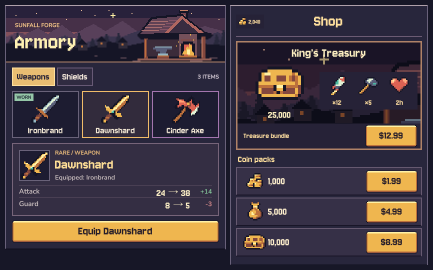
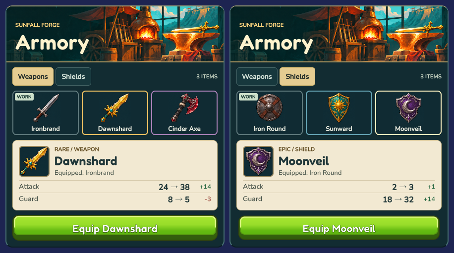
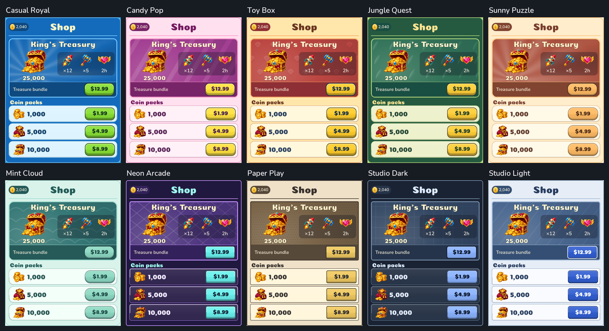
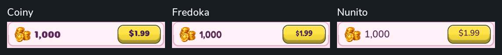

# UiCdn

An MIT-licensed, Editor-only copy-paste component registry for **Unity 6 Runtime UI Toolkit**, inspired by shadcn/ui.

Install components into a project folder of your choice (default `Assets/UI`), customize them, and own every line. Remove the installer package whenever you want; installed UI has zero runtime dependency on it.

The catalog includes Button, Card, Dialog, Tabs, Accordion, Checkbox, Switch, Input, Slider, Badge, Alert, Progress, Separator, and Toast, with composable parts, UXML examples, fluent C# construction, twelve selectable USS themes, focus styling, and navigation support.

Choose from chunky hyper-casual styles, soft puzzle palettes, pixel art, neon arcade, paper, and light/dark themes. Pick Coiny, Fredoka, Nunito or Jersey 10 for titles, actions and prices. The theme and display font apply to both UXML and C# layouts.

Select **Visual style → Pixel Forge** and **Display font → Theme Default** for the pixel sprites and retro lettering shown here.



In **Game UI showcase → Genre / screen**, choose the casual treasure shop or the RPG armory. The armory lets you inspect weapons and shields, compare attack and guard against your current equipment, and equip your selection.







## Install

Install the [published OpenUPM package](https://openupm.com/packages/com.garabandic.uicdn/) from a Unity 6 project directory.

```sh
openupm add com.garabandic.uicdn
```

You can also download the `.tgz` from [GitHub Releases](https://github.com/kantagara/UI-CDN/releases) and choose **Install package from tarball** in Package Manager. For Git installation, choose **Install package from git URL** and paste this address.

```text
https://github.com/kantagara/UI-CDN.git?path=/Packages/com.garabandic.uicdn
```

Open **Window → UiCdn → Component Registry** and drag a folder from the Project window onto **Install folder**. Choose **Install** to copy the component directly there. Clear the field to use `Assets/UI` again. For a local checkout, choose **Install package from disk** and select `Packages/com.garabandic.uicdn/package.json`.

Read the [package documentation](Packages/com.garabandic.uicdn/README.md) for setup, examples, APIs, theming, lifecycle hooks, and the source ownership policy. See [contributing](CONTRIBUTING.md) for development and validation.
